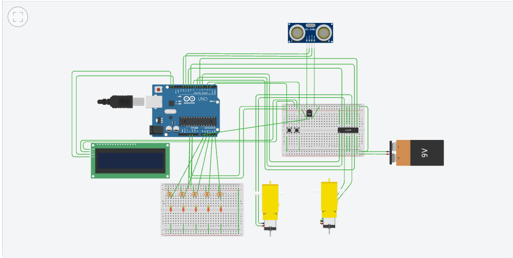

# Line follower robot (Arduino)

An Arduino Uno line-following robot with PID steering and ultrasonic obstacle stop, designed and simulated in **Tinkercad Circuits**, plus the smaller sketches I built on the way (motor driver, ultrasonic, LCD, servo, sensors). Made during an Arduino workshop in August–September 2025.

**Author:** Abdelrahman Sherif

## Line follower ([`line_follower/line_follower.ino`](line_follower/line_follower.ino))

- **Sensing:** five IR line sensors (A1–A5). Each sensor gets its own threshold from a start-up calibration: the robot spins in place for 3 s and records the minimum and maximum reading of every sensor.
- **Steering:** a weighted position error from the five sensors feeds a PID controller that adjusts the speed of the two wheels around a base speed.
- **Obstacle stop:** an HC-SR04 ultrasonic sensor is pinged every 100 ms without blocking the control loop (`millis()`). The robot stops while an obstacle is closer than 100 cm.
- **Display and controls:** a 16×2 I²C LCD, a temperature sensor and two push buttons (calibrate, start).

| Part | Pins |
|---|---|
| L293D H-bridge, motor A (right wheel) | ENA 5, IN1 7, IN2 8 |
| L293D H-bridge, motor B (left wheel) | ENB 6, IN3 9, IN4 10 |
| IR sensors, leftmost → rightmost | A1, A2, A3, A4, A5 |
| HC-SR04 | TRIG 11, ECHO 12 |
| Temperature sensor | A0 |
| Buttons (calibrate, start) | 0, 1 |

Parts list from the report: Arduino Uno, 5-sensor IR array, L293D motor driver, hobby gear motors, 9 V battery, ultrasonic sensor, push buttons.

The full write-up (design, problems met with PID tuning, calibration and timing, code walkthrough) is in [docs/line-follower-report.pdf](docs/line-follower-report.pdf).

## Building blocks

| Sketch | What it does |
|---|---|
| [ultrasonic_lm35](building-blocks/ultrasonic_lm35) | Room-access check from distance + temperature; status ("Access granted", "Overheated room", "Idle") on an I²C LCD |
| [car_collision_detection](building-blocks/car_collision_detection) | DC motor through an H-bridge, braked when an obstacle is closer than 100 cm |
| [dc_motor_driver](building-blocks/dc_motor_driver) | Push button cycles a DC motor forward → reverse → stop; potentiometer sets the speed (PWM) |
| [lcd](building-blocks/lcd) | Text on a 16×2 parallel LCD (`LiquidCrystal`) |
| [servo](building-blocks/servo) | Servo sweep 0° → 180° → 0° |

### Experiments (`building-blocks/experiments/`)

| Sketch | What it does |
|---|---|
| [tmp36_rgb_temperature](building-blocks/experiments/tmp36_rgb_temperature) | TMP36 temperature → RGB LED (blue ≤ 20 °C, green 21–30 °C, red > 30 °C) |
| [ultrasonic_tmp36_room_access](building-blocks/experiments/ultrasonic_tmp36_room_access) | Someone within 100 cm + temperature check → "Access granted" / "Overheated room" / "Idle" on serial and an RGB LED |
| [pot_ldr_led_brightness](building-blocks/experiments/pot_ldr_led_brightness) | Potentiometer and LDR each set an LED's brightness (PWM) |
| [traffic_light](building-blocks/experiments/traffic_light) | Three-LED traffic light sequence |
| [analog_read_serial](building-blocks/experiments/analog_read_serial) | Prints an analog input to the serial monitor once a second |

## Run

Open a sketch folder in the Arduino IDE (board: Arduino Uno) or paste the code into a Tinkercad Circuits project wired as in its `circuit.png`. The line follower and `ultrasonic_lm35` need the `LiquidCrystal_I2C` library.

## License

MIT. See [LICENSE](LICENSE).
